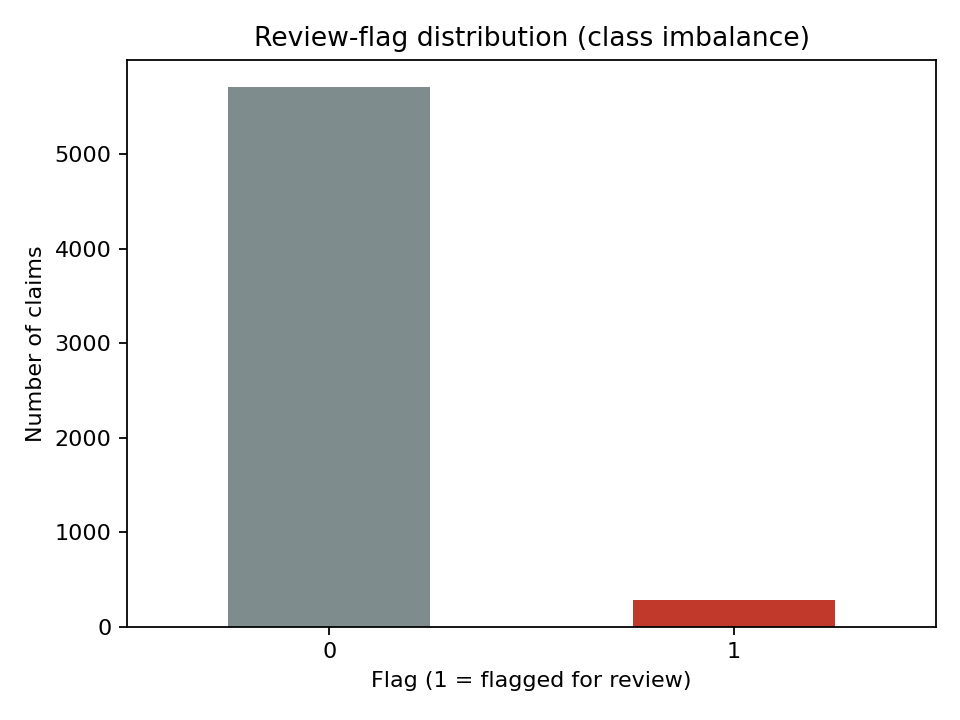
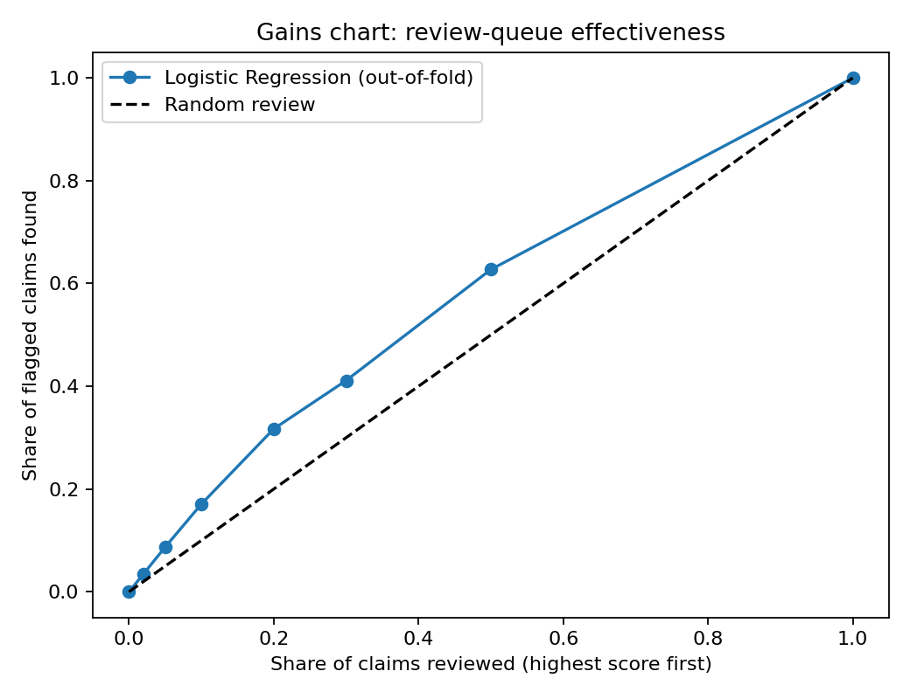
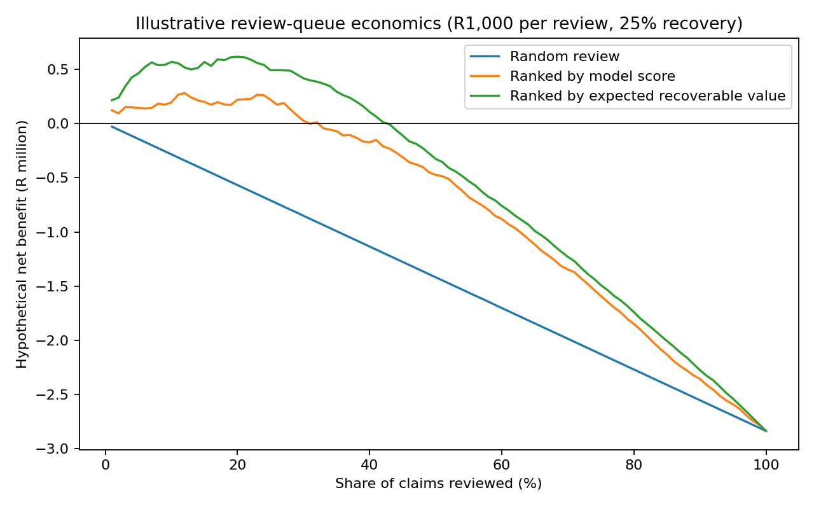

# Insurance Claims Review Prioritisation
**Business decision-making × Data science | Python • SQL • scikit-learn • Visual analytics**

> **Educational portfolio project.** All 6,000 claims are synthetic. The `fraud_review_flag` is a **simulated referral/review indicator, not confirmed fraud**. No customer is accused of fraud; no real insurer's results or savings are claimed.

## Executive summary
**Business problem:** An insurance claims team has limited investigator capacity. Which claims should receive additional human review, and what is the trade-off between investigation cost, workload and financial exposure?

**Analytical approach:** Prepare claim data, investigate patterns, compare three models using **training-only five-fold cross-validation**, then evaluate the chosen model on an untouched 20% hold-out. Separately, use cross-fitted scores for an **illustrative**, non-independent portfolio queue simulation.

**Results (reproduced locally; independent hold-out first):**
- 6,000 synthetic claims; **287 flagged (4.78%)**.
- **Independent hold-out (1,200 claims; 57 flags): ROC-AUC 0.585, average precision 0.063, and 29.8% of review flags captured in the top 20% of claims.** This is a small flagged sample and the capture estimate is noisy.
- Development-only cross-validation: Logistic Regression selected, **ROC-AUC 0.617 ± 0.038**, with **30.4%** of flags captured in the top 20% of development out-of-fold rankings.
- Descriptive full-portfolio cross-fitting: **31.7%** of synthetic review flags in the top 20%; this is **not independent validation**. Weak hold-out discrimination limits real-world usefulness.
- Under *assumed* R1,000 review cost and 25% recovery of flagged claim value, value-based queue ranking produces **about R617,000 hypothetical net benefit** in an in-sample scenario. This is **not a forecast or validated saving**.

## What demonstrates business management thinking?
| Business question | Analytical method | Decision implication |
|---|---|---|
| How should scarce investigators be allocated? | Capacity-constrained ranked review queue | Review high-priority claims first, with human oversight |
| Is model ranking better than random review? | Lift, average precision, ROC-AUC | Compare incremental usefulness against a simple baseline |
| Is a higher-value claim always worth reviewing? | Probability × claim amount | Evaluate financial exposure alongside model score |
| How sensitive are benefits to assumptions? | Review-cost and recovery-rate scenarios | Avoid overstating ROI; test break-even conditions |
| Who must govern the process? | Model card, operational controls, review policy | Claims managers, compliance, investigators and model validators |

## What demonstrates data science thinking?
- **Leakage prevention:** data cleaning retains missing values; train-only pipeline imputation and scaling.
- **Model comparison:** Logistic Regression, Decision Tree, Random Forest selected using training-only cross-validation.
- **Final evaluation:** hold-out set is not used for model selection.
- **Class imbalance:** average precision, lift and review-queue capture rather than accuracy alone.
- **Uncertainty:** configurable label-permutation test (30 permutations by default; increase for more resolution).
- **Interpretability:** logistic coefficients and a model card documenting limitations.

## Key visualisations




## Repository contents
- `src/cleaning.py` — type checks and deterministic business features; missing values retained
- `src/eda.py` — descriptive analysis and charts
- `src/model.py` — development-set model selection, final hold-out evaluation, descriptive queue ranking
- `src/business_impact.py` — workload tiers and **hypothetical** scenario economics
- `src/run_all.py` — complete pipeline
- `data/raw/` and `data/processed/` — synthetic data; see `DATA_PROVENANCE.md` for what is and is not documented about its generation
- `reports/` — reproducible model and scenario outputs
- `visualisations/` — saved charts
- `sql/` — claims portfolio analysis
- `notebooks/` — guided exploration and output inspection
- `BUSINESS_ANALYSIS.md`, `BUSINESS_DECISION_TABLE.md`, `MODEL_CARD.md`, `POWER_BI_DASHBOARD.md`, `INTERVIEW_PREP.md` — decision framing and documentation
- `tests/` — lightweight data and output checks
- `DATA_PROVENANCE.md` — dataset origin and what cannot be reproduced

## Reproduce
```bash
python -m pip install -r requirements.txt
python src/run_all.py
python -m unittest discover -s tests -v
```
For a more precise but slower permutation test: set `FRAUD_PERMUTATIONS=200` in your environment before running. Random seeds are fixed at 42; exact floating-point results may vary slightly across package versions.

## Methodological caveats
1. All records are synthetic; flag associations may reflect the data generator rather than real-world insurance behaviour.
2. The target represents a *review flag*, not a verified fraud outcome. Recovery assumptions are not inferred from the target.
3. The queue-economics exercise uses out-of-fold scores on the full synthetic portfolio and **selects the best review share on the same portfolio**. It is a scenario illustration, **not an independently tested policy return**.
4. Missing claim amounts are conservatively assigned zero *only for hypothetical financial exposure calculations*; model imputations are fitted within each training fold.
5. No fairness assessment, external validation, real investigator feedback, calibration certification or production deployment is claimed.

## Data provenance
The dataset is synthetic (simulated), not real customer data. **The generation method, code and random seed are not documented**, so this repository does not include a data generator. The raw CSV is versioned as a fixed input so the analysis is reproducible; see `DATA_PROVENANCE.md`.

## Recommended next steps
Validate on representative, governed real-world data; test operational queue thresholds prospectively; obtain actual review costs and confirmed recovery outcomes; perform fairness, privacy and monitoring reviews. A Power BI report is **specified**, not delivered as a `.pbix`.

## Author
**Joston Mathabathe** — BCom Business Management | Postgraduate Diploma in Data Science
[GitHub](https://github.com/Joston-Mathabathe) · [LinkedIn](https://www.linkedin.com/in/joston-mathabathe)
